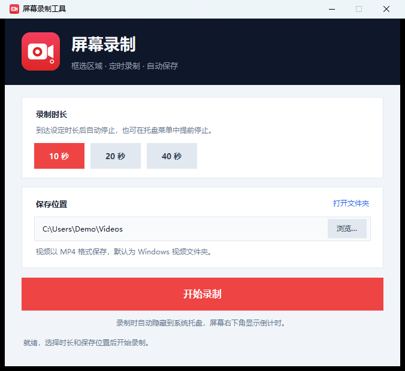

# 屏幕录制工具

Windows 桌面屏幕区域录制工具。选择 10 / 20 / 40 秒录制时长，拖拽框选任意屏幕区域，录制时自动隐藏到系统托盘，并在屏幕右下角显示倒计时。录制完成后主界面自动弹出并提示保存结果。



## 功能

- 全屏拖拽框选录制区域，支持多显示器与高 DPI 屏幕。
- 三档录制时长：10 秒、20 秒、40 秒，到点自动停止。
- 保存目录可自由选择，默认使用 Windows“视频”文件夹。
- 录制开始后主窗口自动隐藏到系统托盘，右下角显示录制倒计时。
- 倒计时浮层已做捕获排除（Windows 10 2004+），尽量不出现在成片中。
- 托盘菜单支持“停止并保存”“取消录制”“退出程序”。
- 录制完成后自动恢复主界面，显示文件名、时长、大小，并可打开所在文件夹。
- 自动避开重名文件，视频以 MP4 保存；记住上次的时长与保存目录。
- 全程本地运行，不联网、不上传任何内容。

## 环境要求

- Windows 10 / 11
- Python 3.12+
- 依赖：`mss`、`numpy`、`opencv-python`
- 无需单独安装 FFmpeg，视频编码使用 OpenCV 自带的 MPEG-4 编码器。
- Tkinter 随 Windows 版 Python 一起安装。

## 安装与启动

在项目目录中执行：

```powershell
python -m pip install -e .
python run.py
```

不希望保留控制台窗口时，可以使用 `pythonw run.py` 启动；运行日志仍会写入
`%LOCALAPPDATA%\ShortVideoCapture\app.log`。

也可以安装后直接运行命令：

```powershell
screen-recorder
```

只安装依赖、不安装项目时，仍然可以直接启动：

```powershell
python -m pip install mss numpy opencv-python
python run.py
```

## 使用方法

1. 在主界面选择录制时长（10 秒 / 20 秒 / 40 秒）。
2. 确认“保存位置”，可点击“浏览…”选择其他文件夹。
3. 点击“开始录制”。
4. 屏幕变暗后按住鼠标左键拖动，框选要录制的区域；松开后可调整或重新框选。
5. 点击“开始录制”或按 `Enter` 开始；按 `Esc` 或右键取消。
6. 录制期间主界面隐藏到系统托盘，右下角显示倒计时。
7. 到点自动停止（也可右键托盘图标选择“停止并保存”），主界面自动弹出“录制完成”提示。

框选阶段快捷键：

| 操作 | 快捷键 |
| --- | --- |
| 开始录制 | `Enter` |
| 取消框选 | `Esc` |
| 取消框选（鼠标） | 右键 |

## 输出与配置

- 默认输出目录：Windows 已知文件夹“视频”，通常为 `C:\Users\<用户名>\Videos`。
- 文件名格式：`屏幕录制_2026-10-19_08-30-05.mp4`；重名时自动追加 `_2`、`_3`。
- 用户设置：`%APPDATA%\ShortVideoCapture\settings.json`
- 运行日志：`%LOCALAPPDATA%\ShortVideoCapture\app.log`

## 已知限制

- 当前版本只录制画面，不录制系统声音或麦克风。
- 屏幕采集不包含鼠标指针。
- 编码固定为 20 FPS、MP4（MPEG-4 Part 2）。高分辨率超长录制会占用较多 CPU 和磁盘空间。
- “倒计时不出现在成片中”依赖 Windows 10 2004 及以上版本提供的捕获排除接口；旧系统上倒计时若与选区重叠，可能会被录进画面。
- 系统托盘依赖 Windows 资源管理器。在低完整性/受限进程中运行导致托盘不可用时，程序会退回到任务栏最小化继续录制，并按时自动完成。

## 项目结构

```text
.
├── run.py                         # 免安装启动入口
├── pyproject.toml                 # 依赖与打包配置
├── src/short_video_capture/
│   ├── app.py                     # 主界面与录制流程
│   ├── capture.py                 # 屏幕采集、编码、时长补齐
│   ├── config.py                  # 本地设置读写
│   ├── countdown.py               # 右下角倒计时浮层
│   ├── paths.py                   # 默认目录、文件名、打开文件夹
│   ├── region_selector.py         # 全屏框选与确认工具条
│   ├── tray.py                    # Win32 系统托盘
│   ├── win32.py                   # DPI、屏幕区域、捕获排除
│   └── assets/                    # 应用图标
├── tests/                         # unittest 自动化测试
└── docs/screenshot-main.png       # 界面截图
```

## 测试

```powershell
python -m unittest discover -s tests -v
```

测试覆盖录制核心（测试注入的假屏幕/假编码器）、停止与取消、选区尺寸规范化、输出路径去重、中文/空格目录、配置读写与损坏配置回退。

界面与真实屏录已在 Windows 上手动验证：启动主界面、框选、倒计时、系统托盘不可用时的任务栏回退、提前停止、取消、录制完成弹窗与 MP4 可播放性。
