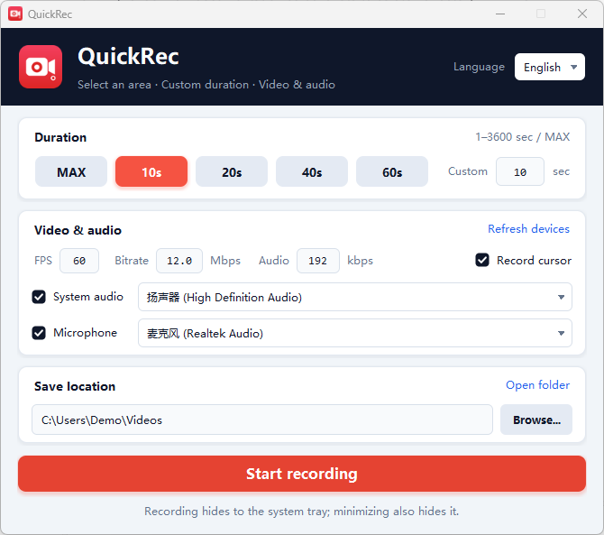
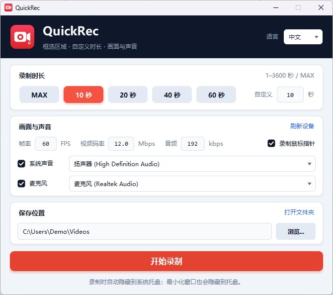

# QuickRec

[中文](README.md) | **English**

A Windows desktop screen region recording tool. Drag to select any region of your screen and record for 10 / 20 / 40 / 60 seconds or `MAX`, with support for custom durations, video quality settings, system audio, microphone input, and a bilingual 中文 / English UI.



## Features

- Compact modern rounded UI: The main window, post-selection action toolbar, and bottom-right countdown overlay all use pure Tkinter + NumPy anti-aliased rounded widgets for a cohesive look without extra UI library dependencies.
- Full-screen drag-to-select recording region with multi-monitor and high-DPI support.
- Duration presets: 10 / 20 / 40 / 60 seconds; `MAX` records without a time limit until you click stop.
- You can also enter any integer between 1 and 3600 seconds (up to 1 hour) in **Custom**.
- Interface language: 中文 / English; switching rebuilds the UI immediately and saves your choice.
- Video quality: Adjustable 5–60 FPS and 0.5–50 Mbps video bitrate.
- The mouse cursor is drawn into the recording by default and can be disabled under **Video & audio**.
- Audio: Record **System audio** (speaker loopback) and **Microphone** individually or simultaneously, select specific devices, and set the AAC audio bitrate.
- Video uses H.264 encoding (automatically detects GPU hardware acceleration for NVIDIA NVENC / Intel QSV / AMD AMF, and seamlessly falls back to CPU encoding when hardware support is unavailable or the capture region is small; can be forced via the `QUICKREC_VIDEO_ENCODER` environment variable), and audio uses AAC, muxed into an MP4 file.
- Performance optimization & low CPU usage: Uses Win32 GDI shared memory (`DIBSection`) zero-copy screen capture, localized cursor patching (avoiding full-frame copies on every frame), efficient pipe buffering, and high-precision timing to greatly reduce CPU usage during recording.
- Customizable save location, defaulting to the Windows **Videos** folder; if that folder is not writable, QuickRec automatically switches to an `output` folder in the application directory on startup and shows a notice in the bottom hint line.
- Folder selection uses a built-in pure-Tk directory picker instead of Windows Shell dialogs, preventing hangs in restricted environments.
- After recording starts, the main window automatically hides to the system tray and a countdown overlay appears in the bottom-right corner with a **Stop** button to finish and save at any time.
- Clicking the minimize button in the top-right corner also hides the window to the system tray; you can restore the main window from the tray menu.
- The countdown overlay enables capture exclusion (Windows 10 2004+) so it does not appear in the recorded video whenever supported.
- When recording finishes, the main window automatically reappears, showing the file name, duration, file size, video quality, and audio info, along with a button to open the containing folder.
- Automatically avoids duplicate file name collisions; remembers your last used duration, quality settings, audio devices, language, and save location.
- Runs 100% locally—no network connection and no data uploaded.

## Interface Language

Select **中文** or **English** in the top-right corner of the window. Your language choice is saved to the settings file for future launches, and the countdown overlay, region selector, directory picker, tray menu, and dialogs update accordingly.



## Requirements

- Windows 10 / 11
- Python 3.12+
- Dependencies: `mss`, `numpy`, `soundcard`, `imageio-ffmpeg`
- Building the `.exe` additionally requires `pyinstaller` (only needed on the build machine)
- `soundcard` uses Windows WASAPI for system audio loopback and microphone capture.
- `imageio-ffmpeg` bundles an FFmpeg binary, so no separate FFmpeg installation is required.
- Tkinter is included with the standard Windows Python installer.

## Installation & Launch

Run in the project directory:

```powershell
python -m pip install -e .
python run.py
```

If you do not want to keep a console window open, launch with `pythonw run.py`; runtime logs are still written to `%LOCALAPPDATA%\QuickRec\app.log`.

If the project contains a `.venv` with dependencies installed while the current `python` is missing audio/video packages, `run.py` automatically relaunches using `.venv\Scripts\pythonw.exe` to avoid missing-audio-component warnings. You can also run it manually:

```powershell
.\.venv\Scripts\python run.py
```

After installation, you can also run the command directly:

```powershell
quickrec
```

## Packaging as an Executable (.exe)

Requires 64-bit Python 3.12+. If you do not have a `.venv` virtual environment yet, create one in the project root and install the project dependencies along with `pyinstaller`:

```powershell
python -m venv .venv
.\.venv\Scripts\python.exe -m pip install -e . pyinstaller
```

(If you already have a `.venv` with the project dependencies installed, simply ensure `pyinstaller` is installed: `.\.venv\Scripts\python.exe -m pip install pyinstaller`.)

The repository includes both one-file and one-directory PyInstaller specs and a unified build script:

Directory mode (recommended—faster startup, no runtime unpacking on every launch):

```powershell
.\.venv\Scripts\python.exe packaging\build_exe.py --mode onedir
```

Output:

```text
dist\QuickRec\
├── QuickRec.exe
└── _internal\...
```

When distributing, keep the entire `dist\QuickRec` folder intact (you can zip it and copy it to other PCs); target machines do not need Python, Tk, or FFmpeg installed.

Single-file mode:

```powershell
.\.venv\Scripts\python.exe packaging\build_exe.py --mode onefile
```

Outputs a single file at `dist\QuickRec.exe`.

The build script runs the unit tests first, invokes PyInstaller, and then runs a smoke test on the built executable to verify dependency imports, the app icon, Tk, screen capture, bundled FFmpeg H.264/AAC encoding, and audio device enumeration.

Common options:

| Option | Description |
| --- | --- |
| `--mode onedir` | Directory mode (recommended); outputs to `dist\QuickRec\` |
| `--mode onefile` | Single-file mode; outputs `dist\QuickRec.exe` (default) |
| `--skip-tests` | Skip unit tests (not recommended) |
| `--skip-smoke-test` | Skip the build smoke test (for restricted sandboxes or headless environments) |

You can also invoke PyInstaller directly:

```powershell
.\.venv\Scripts\python.exe -m PyInstaller --noconfirm --clean packaging\short_video_capture_onedir.spec
.\.venv\Scripts\python.exe -m PyInstaller --noconfirm --clean packaging\short_video_capture.spec
```

Packaging notes:

- Directory mode does not unpack dependencies at startup, so it launches faster and works better under restricted accounts or low-privilege sandboxes; do not separate `QuickRec.exe` from `_internal` when copying.
- Single-file mode extracts the runtime into the system temp directory on first launch, which takes slightly longer to start; in restricted sandboxes it may report `Failed to extract VCRUNTIME140.dll`, which does not mean the build is broken—verify it on a normal desktop or use directory mode.
- The executable is not code-signed. When copied to another PC and run for the first time, Windows SmartScreen may warn about an "Unknown publisher"; click **More info → Run anyway**.
- A few antivirus tools may flag PyInstaller executables as false positives; you can add it to your allowlist or run from source instead.
- Do not place the executable in a read-only directory: if the Windows **Videos** folder is not writable, recordings will be saved to an `output` folder next to the executable.

## Usage

> [!IMPORTANT]
> It is strongly recommended to run this software with administrator privileges. Otherwise, the software will be unable to minimize to the system tray or use the system's default video save path.

1. Choose a recording duration: click the `10s` / `20s` / `40s` / `60s` preset buttons, click `MAX` for unlimited duration, or enter seconds in the **Custom** input box (supports Up/Down arrow keys).
2. Configure **Video & audio**:
   - Adjust **FPS** (5–60), **Bitrate** (Mbps), and **Audio** (kbps) inline, with direct typing or Up/Down arrow key nudging.
   - Check **Record cursor** to render the mouse pointer into the video.
   - Check **System audio** and pick a speaker device to record audio playing on your PC.
   - Check **Microphone** and pick a microphone device.
   - Click **Refresh devices** to re-enumerate devices after hardware changes.
3. Verify the **Save location**, or click **Browse...** to choose another folder.
4. Click **Start recording**.
5. Once the screen dims, hold the left mouse button and drag to select the recording area; release to finish or drag again to reselect.
6. Click **Start recording** or press `Enter` to begin; press `Esc` or right-click to cancel.
7. During recording, the main window hides to the system tray and a countdown appears in the bottom-right corner (`MAX` mode displays elapsed recording time).
8. Recording stops automatically when time runs out; you can also click **Stop** on the countdown overlay or right-click the tray icon and choose **Stop and save**. The main window will reappear with a **Recording complete** summary.

Region selection shortcuts:

| Action | Shortcut |
| --- | --- |
| Start recording | `Enter` |
| Cancel selection | `Esc` |
| Cancel selection (mouse) | Right-click |

Minimizing the window:

- Clicking the minimize button while idle removes the window from the taskbar and hides it to the system tray.
- Right-click the tray icon and select **Show QuickRec** to restore it.
- The window also hides to the tray during recording and automatically reappears once recording finishes.

## Output & Configuration

- Default output directory: Windows known folder **Videos**, typically `C:\Users\<Username>\Videos`.
- File naming format: `QuickRec_2026-10-19_08-30-05.mp4`; appends `_2`, `_3`, etc. automatically if a file with the same name exists.
- Video: H.264, with frame rate and video bitrate controlled by the main window settings.
- Audio: 48 kHz stereo AAC; when both system audio and microphone are enabled, they are mixed into a single audio track.
- User settings: Stored in `settings.json` in the application directory and created on first launch (safe to inspect, back up, or delete); legacy settings from `%APPDATA%\QuickRec` or `ShortVideoCapture` are automatically read and migrated on first launch.
- Runtime log: `%LOCALAPPDATA%\QuickRec\app.log`

## Known Limitations

- **Video bitrate** acts as a target/cap; actual file bitrate varies with scene complexity, and static screens will typically produce noticeably lower bitrates than the configured target.
- System audio relies on speaker loopback via Windows WASAPI and your sound card driver; some Bluetooth devices or virtual audio devices may not support loopback.
- System audio and microphone input are mixed into a single audio track rather than stored as two separate tracks.
- The mouse cursor is composited frame-by-frame into the video; unchecking **Record cursor** excludes it from the output video.
- High resolution + high frame rate (e.g., 4K / 60 FPS) automatically enables GPU hardware encoding on supported graphics cards to significantly lower CPU load, though high-bitrate and long recordings still consume substantial disk space—make sure the target drive has enough free space.
- Excluding the countdown overlay from the recording relies on the Windows 10 2004+ capture-exclusion API; on older Windows versions, the countdown may appear in the video if it overlaps the selected region.
- System tray integration depends on Windows Explorer. When running in a low-integrity or restricted process where the tray is unavailable, QuickRec falls back to minimizing to the taskbar and continues recording until completion.

## Project Structure

```text
.
├── run.py                            # Source launch entry point
├── pyproject.toml                    # Dependencies and packaging metadata
├── packaging/
│   ├── build_exe.py                  # One-file / one-dir build & smoke test script
│   ├── launcher.py                   # PyInstaller entry point
│   ├── short_video_capture.spec      # One-file PyInstaller spec
│   ├── short_video_capture_onedir.spec # One-dir PyInstaller spec
│   └── version_info.txt              # Executable version metadata
├── src/short_video_capture/
│   ├── app.py                        # Main window & recording workflow
│   ├── capture.py                    # Screen capture & frame scheduling
│   ├── media.py                      # FFmpeg H.264 encoding & command builder
│   ├── audio.py                      # WASAPI device enumeration & audio capture
│   ├── pipeline.py                   # Video, audio & muxing pipeline
│   ├── config.py                     # Settings & input validation
│   ├── i18n.py                       # Bilingual UI copy (Chinese / English)
│   ├── directory_picker.py           # Pure-Tk folder picker
│   ├── countdown.py                  # Bottom-right countdown & stop overlay
│   ├── cursor.py                     # Frame-by-frame mouse cursor compositing
│   ├── paths.py                      # Default directories, filenames, open folder
│   ├── region_selector.py            # Full-screen region selection & toolbar
│   ├── tray.py                       # Win32 system tray integration
│   ├── widgets.py                    # Pure-Tk + NumPy anti-aliased rounded widgets
│   └── win32.py                      # DPI, screen bounds, capture exclusion
├── tests/                            # unittest automated test suite
├── docs/screenshot-main-zh.png       # Chinese UI screenshot
├── docs/screenshot-main-en.png       # English UI screenshot
└── docs/screenshot-countdown.png     # Countdown & stop overlay screenshot
```

## Testing

```powershell
python -m unittest discover -s tests -v
```

Test coverage includes frame-by-frame recording scheduling, high-FPS frame padding, `MAX` unlimited recording stop, Win32 GDI capture and localized cursor patching, hardware encoder probing and small-region fallback, automatic fallback to `libx264` on first-frame pipe errors, frame-by-frame cursor compositing, stop and cancel behavior, FPS/bitrate/duration validation, audio/video muxing commands, audio device name deduplication, region normalization, output filename deduplication, write-permission probing, the Tk directory picker, paths with Chinese characters or spaces, settings persistence and corrupted-config fallback, anti-aliased rounded widget and indicator rendering, and bilingual copy & language fallback.

The UI and real recordings have been manually verified on Windows: launching the main window, switching between Chinese and English, region selection, 60s and `MAX` presets, the countdown stop button, custom duration, H.264 video, cursor rendering, system audio + microphone mixing, early stop, cancellation, completion dialog, minimize-to-tray behavior, restricted-directory fallback, built-in folder picker, and MP4 playback.
